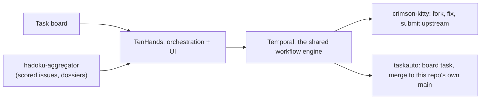

# Contributing

How to run TenHands, where things live, and what ships to production. What
it does for a reader or operator is in [features.md](features.md). Read
[`AGENTS.md`](../../AGENTS.md) first — it is short, and records the rules
that have regressed before.

## Run it locally

Needs Python 3.8+, Node.js 20+ with pnpm, and the
[GitHub CLI](https://cli.github.com/) (`gh`) authenticated via `gh auth
login` — crimson-kitty's activities shell out to it for every GitHub
operation (forking, PRs, issue comments).

```sh
python -m venv .venv                                # repo root — matches the deploy
.venv/bin/pip install -r backend/requirements.txt
.venv/bin/pip install -r backend/requirements-dev.txt   # test-only deps
cp .env.example .env    # external/offline dev only — production has no .env files
.venv/bin/python -m backend.app
```

The API starts on `http://localhost:5024`. For the frontend:

```sh
cd frontend && pnpm install && pnpm dev   # :5184, proxies API calls to the backend
```

**This checkout is production.** The pm2 services run from this exact
working directory, and a deploy does `git reset --hard origin/main` against
it — which eats any uncommitted work in the tree. Do real work in a git
worktree (`git worktree add .claude/worktrees/<task> -b <branch>`), which a
deploy never touches, and commit and push promptly rather than leaving
changes sitting in the live checkout.

## How it fits together



TenHands calls a separate scoring service (`hadoku-aggregator`, a public
repo) for issue scores, repo health and dossiers, and falls back to a small
built-in heuristic (`backend/helpers/oss_helpers.py`) when that service is
unreachable — deliberately minimal, and not meant to be extended. A third,
separate service indexes repo metadata on a daily cron and feeds the
scoring service; TenHands never talks to it directly.

| Concern | Owner |
|---|---|
| Repo scraping and indexing | the daily-cron indexer |
| Issue scoring, reaction/sentiment analysis, dossiers and issue briefs, repo health | `hadoku-aggregator` |
| Fork management, agent context, agent assignment, PR review orchestration, upstream submission, the pipeline UI | TenHands (this repo) |

| Path                 | What it is                                                                                                                                                                                                             |
| -------------------- | ----------------------------------------------------------------------------------------------------------------------------------------------------------------------------------------------------------------- |
| `backend/routes/`     | Flask blueprints. `oss_routes_stage1` through `stage5` are the original five-stage pipeline (`oss_routes_retro` its retrospective data); `temporal_routes` is crimson-kitty; `taskauto_routes` is the board pipeline; `automation_routes` is automation presets and the OpenAPI surface; `health_routes` and `action_routes` are the health check and batch actions; `debug/` is read-only, admin-gated diagnostics. |
| `backend/temporal/`   | The shared engine: `workflows/` (the Temporal workflow definitions), `activities/` (fork, eligibility, agent dispatch, review, submission, watchers), `gates/` (the gate registry), `agents/` (the Copilot adapter and a no-op for testing — any other agent backend implements the same `StageDispatcher` interface: `dispatch()`, `check_status()`, `collect_results()`), `taskauto/` (the board scheduler, runner and reconciler), `judge.py` (the LLM judge), `sanitizer.py` (upstream-reference scrubbing), `calibration.py` (the judge's calibration harness, 20 hand-scored fixtures). |
| `backend/services/`  | Business logic: the aggregator client, fork management, agent dispatchers, and the file-based cache (configurable TTL via `FLASK_ENV`) that backs offline/fallback mode. |
| `backend/middleware/` | Request identity (`whoami.py`). |
| `frontend/src/`       | React 19 + TypeScript (built with Vite, published to GitHub Packages as `@wolffm/tenhands`), Zustand for state. One view per pipeline (`views/`), a typed API client (`api/`), per-pipeline panels (`components/`), `store/` (Zustand stores), `hooks/` (batch actions, review actions, theme), `utils/` (formatters, diff renderer, severity helpers). `e2e/` splits `local/` (mocked APIs) from `prod/` (production smoke tests) and shared `fixtures/`. |
| `scripts/`            | The operator CLI: `dispatch_batch`, `retro_report`, `snapshot_outcomes`, `copilot-sessions`, `taskauto_run`.                                                                                                                              |

**Deeper design docs**, in the order they earn a read:

- [Phase 4 bug catalog](../crimson-kitty/phase4-retrospective.md) — every
  bug from crimson-kitty's first external dispatch attempts, each with
  class, root cause, fix and lesson.
- [Phase 3 final report](../crimson-kitty/phase3-final-report.md) — the
  before/after PR-title proof that context plumbing works.
- [Surprise log](../crimson-kitty/smoke-phase3-surprise-log.md) — all 13
  behaviors the operator did not expect during smoke testing, with
  dispositions.
- [Observation report](../crimson-kitty/smoke-phase3-observation-report.md)
  — the per-issue trace behind the numbers above.
- crimson-kitty's own design docs: [docs/crimson-kitty/](../crimson-kitty/README.md).
- taskauto's own docs: [docs/hadoku-task-automation/](../hadoku-task-automation/README.md),
  including its [day-one run report](../hadoku-task-automation/run-report-2026-07-25.md)
  and the negotiated [board contract](../hadoku-task-automation/board-contract.md).

## Access control

There is no `ADMIN_KEY` anywhere in this backend. Every route resolves the
caller's tier from the `X-User-Key` header the edge injects
(`backend/app.py`, `_enforce_tier`): friend tier and up may read; a mutating
request additionally needs service tier **and** a seat on the
`tenhands-write` access list (an admin account is not automatically on it).
The debug routes gate separately, at admin tier specifically
(`backend/routes/debug/_middleware.py`).

## Tests and gates

```sh
cd backend && python3 -m pytest tests/ -q      # zero skips, always
cd frontend && pnpm exec playwright test --project local   # mocked APIs
cd frontend && pnpm exec playwright test --project prod    # real APIs, production smoke
```

**Zero skips, by rule.** A test that needs a credential fetches it through
the vault helper rather than skipping when the environment lacks one — a
`skipif` on a missing secret reads identically to a passing test in CI
output. The one sanctioned exception is the LLM judge's real-CLI test, which
skips only when the account's own usage quota is exhausted, with the reset
time printed in the reason.

CI (`.github/workflows/test.yml`) runs on every PR and every push to
`main`: the backend suite, the real-CLI judge test, the frontend's lint,
typecheck and unit tests, and the local e2e project. Each of those test jobs
ends with a `report-tests` step that posts every test, red runs included, to
the fleet's test store. Each job is its own suite: `backend`,
`judge-integration`, `frontend-unit`, `e2e`, and `backend-fork` for an outside
author's PR. pytest
writes JUnit XML for it and both Playwright configs write a JSON report to
`frontend/reports/`. A separate static-analysis workflow (VibeCheck) and the
`taskauto.yml` runner round out the gates.

## How it ships

Production has no `.env` files; secrets come from a vault broker under a
per-repo, per-key access list, and this repo tracks only the names of the
environment variables it needs, in `.devvault.json` (no values, commit-safe).
A push to `main` is itself a live deploy target — the backend's own pm2
services run from this checkout and are reset to `origin/main` by the deploy
process, which is exactly why real work happens in a worktree, never in this
checkout directly.

## Trivia

The repo's own Copilot agents create draft PRs and never undraft them — work
on a dispatch is considered done the moment commits appear on the branch,
not when the PR's own status changes.
