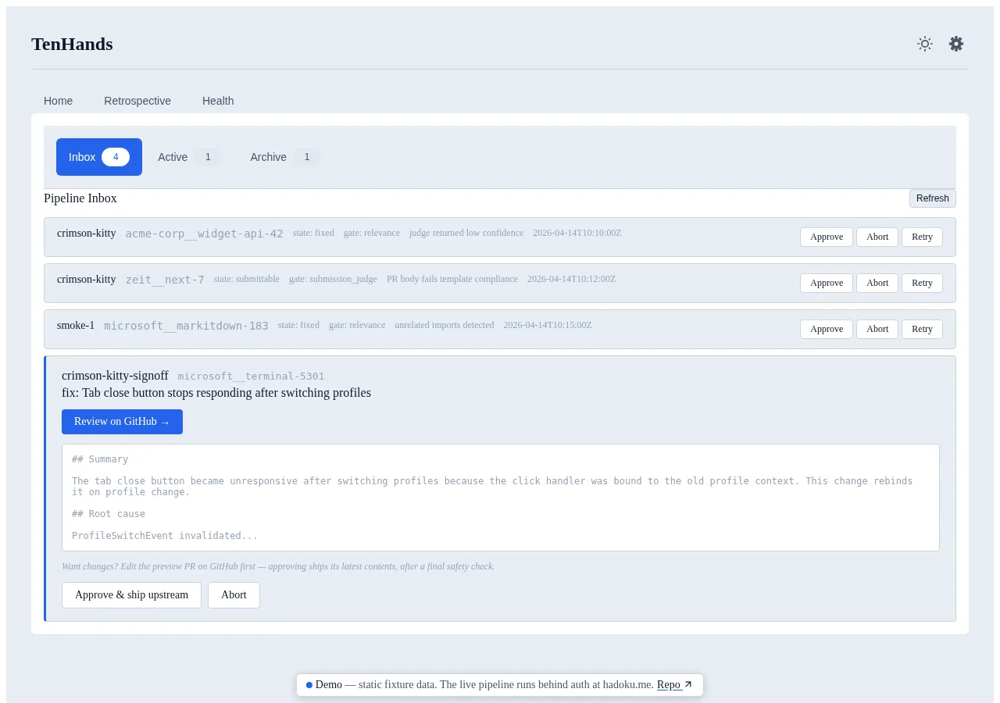
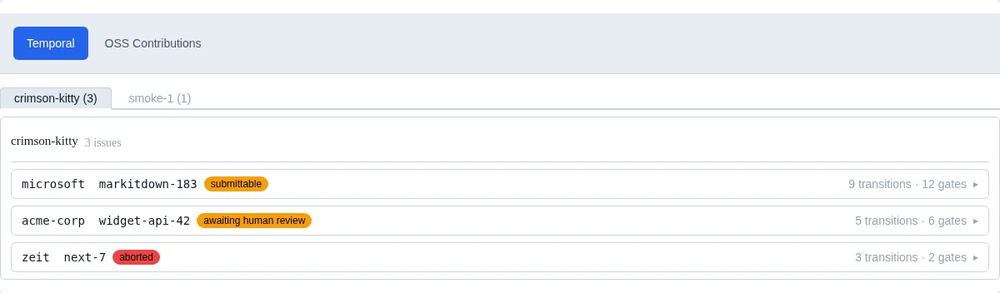

# Features

What TenHands does, for someone reading or operating it. How it works
inside is in [contributing.md](contributing.md). "Friend," "service" and
"admin" are hadoku.me account tiers; the app's own floor for even opening the
dashboard is friend.

## Pipeline dashboards

**What it does.** A page per pipeline: the legacy five-stage OSS pipeline
(target repos, scored issues, fork & assign, review on fork, submit
upstream), the crimson-kitty Temporal pipeline, the taskauto board pipeline,
the retrospective view, a review queue, and a health check. Every past
pipeline stays visible rather than being deleted when a newer one replaces
it — old batches are the record, not clutter.

**How to use it.** Open the frontend and pick a view from the pipeline
selector. Everything here is read-only: issue scores, dossiers, gate
verdicts, Temporal workflow state, the task board's own view of a claim.

**What it does not do.** Nothing on these pages dispatches, approves or
merges anything — every mutating action needs service tier and a seat on
the operator access list, below.

## crimson-kitty

**What it does.** Finds a real bug in a real open-source repo, reproduces
it, fixes it, and verifies the fix with a sandboxed test run. Only once a
human operator explicitly signs off does it open a pull request upstream,
and it keeps watching what happens to it. It is one Temporal workflow with 20
states, and every transition that matters is backed by an evidence
artifact rather than a model's own say-so: a reproduction log, a diff, a
test run's real output.

**How to use it.** `GET /temporal/*` (via the frontend's Temporal pipeline
view) shows a workflow's current state and its evidence trail. Starting a
new dispatch, or moving a workflow past operator signoff, is a mutating
action and needs service tier.

**What it does not do.** It never notifies an upstream maintainer before a
human has explicitly approved the submission — see
[cross-reference isolation](#cross-reference-isolation). An eligibility or
reproduction gate that cannot confirm its own evidence aborts the run rather
than guessing; an abort with a clear reason counts as a success here, not a
failure.

## taskauto

**What it does.** The same Temporal engine as crimson-kitty, aimed at a task
board instead of a scored upstream issue, and landing by merging straight to
this repo's own `main` instead of opening an upstream PR. It runs
unattended: the scheduler can find and act on a task with nobody prompting
it. Every merge is gated on the full test suite passing against the merge
result — the branch with current `main` merged in, not the branch alone —
because unrelated commits landing between a dry run and the live run have
caused real failures before.

**How to use it.** Work arrives by typing a task as a sentence on the shared
board; `hadoku-task-automation`'s own board contract
([docs/hadoku-task-automation/](../hadoku-task-automation/README.md)) is the
negotiated API between this pipeline and the board. Operating it (claiming a
task, forcing a run) is a mutating action and needs service tier.

**What it does not do.** It never opens an upstream PR — that half of the
engine belongs to crimson-kitty. A task the pipeline cannot verify against
the full suite is not merged on a partial or best-effort basis.

## Evidence gates and the LLM judge

**What it does.** A registry of named gates, each one mapped to a specific
failure class jade-hare taught (an empty diff, an unreproducible issue, a
submission with no real fix), judges every transition. An LLM judge — a
`claude` CLI subprocess, not a hand-rolled heuristic — scores a candidate
issue's relevance and a candidate submission's quality before anything
proceeds, calibrated against a set of hand-scored fixtures.

**How to use it.** Each gate's registry entry and the jade-hare bug class it
kills is catalogued in
[docs/crimson-kitty/gates.md](../crimson-kitty/gates.md). The judge itself is
`backend/temporal/judge.py`; `backend/temporal/calibration.py` is its
calibration harness.

**What it does not do.** A gate that cannot get real evidence (a sandbox that
will not start, a judge call that fails) reports that it could not look; it
does not pass by default. The empty-diff gate alone accounted for the
single highest-ROI fix in the whole system — killing 21% of jade-hare's
failures by itself (`d185227`).

## Cross-reference isolation

**What it does.** GitHub auto-generates a notification to an upstream issue
the moment any fork content mentions it — by URL, by `owner/repo#N`, or by a
closing keyword like `Fixes #N`. So every piece of agent-facing content (a
fork's context issue, its title, its body) is scrubbed of upstream
references before an agent ever sees it, and a real link to the upstream
issue is written back in only at the moment of explicit, human-approved
submission.

**How to use it.** The scrubbing runs automatically, inside
`backend/services/oss_service.py` (`_sanitize_upstream_refs`) and
`backend/temporal/sanitizer.py`; nothing an operator has to remember to
invoke. [docs/crimson-kitty/cross-ref-isolation.md](../crimson-kitty/cross-ref-isolation.md)
is the design record.

**What it does not do.** It does not just redact the obvious case — a
cross-reference leak has regressed before and is treated as a real
production bug whenever it is found again, not a cosmetic slip.

## The retrospective system

**What it does.** Reads what actually happened in a finished batch — above
all, a maintainer's own review comments, the single most important signal
the system tracks — before the next batch is designed. Batches get a
memorable `{adjective}-{animal}` identity so they can be discussed and
compared by name.

**How to use it.** The retrospective view in the frontend, or
`scripts/retro_report.py` directly. The retrospective is deliberately
read-only: acting on what it finds happens in the next batch's design, never
inside the retrospective itself.

**What it does not do.** It does not re-run or re-score a closed batch; it
only reports on what already happened.

## Operating the pipeline

**What it does.** Dispatching a new batch, approving a step, claiming or
releasing a task, forcing a signal into a stuck workflow — every action that
changes pipeline state rather than just reading it.

**How to use it.** Any `POST`, `PUT`, `PATCH` or `DELETE` route under the
API. The caller's tier comes from the `X-User-Key` header the edge resolves;
service tier alone is not enough — the caller also needs a seat on the
`tenhands-write` access list, and an admin account is not exempt from that
list (`backend/app.py`).

**What it does not do.** A friend who can see the whole dashboard cannot
trigger any of it. A request with no key at all is refused outright, not
quietly downgraded to a read.

## Debug diagnostics

**What it does.** Read-only internals one level deeper than the ordinary
dashboards: a run's fork state, its assignment history, and tracking data
for debugging a stuck or misbehaving pipeline run.

**How to use it.** The debug routes under the API, gated separately from
everything else.

**What it does not do.** TenHands holds no admin secret of its own for
this — there is deliberately no API key that unlocks it. Only a caller
whose tier itself resolves to admin gets in
(`backend/routes/debug/_middleware.py`, `require_admin`).

## Trivia

The project holds no admin credential of its own anywhere in this backend —
access control for every route, debug included, is a tier resolved from the
caller's own identity, never a shared secret this repo stores
(`backend/routes/debug/_middleware.py`).
