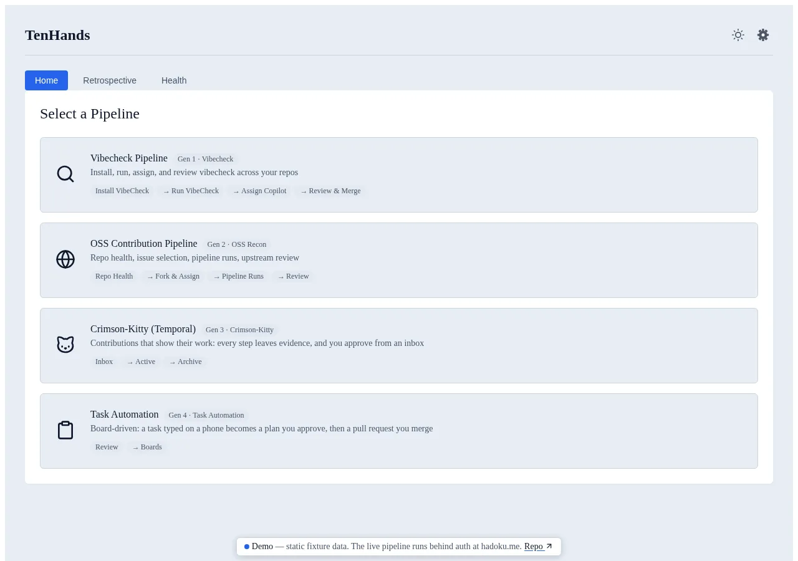

# TenHands

TenHands dispatches coding agents at real work, and is built around the
discipline of earning the right to ship what they produce. The project
funded that discipline the hard way. Its **jade-hare** batch (March 2026)
dispatched 55 issues to real open-source repos and merged exactly one
upstream — with empty diffs, maintainer "AI slop" callouts, and a handful of
cross-reference notifications that reached upstream maintainers before any
human had reviewed the work (`d185227`). Everything since has been built to
make that ratio structurally impossible to repeat.

**Two pipelines share one engine.** **crimson-kitty** is the OSS-contribution
pipeline: eligibility, fork, reproduce, fix, verify, review, operator
signoff, upstream submission, then watching what happens, as one 20-state
Temporal workflow where every transition needs an evidence artifact.
**taskauto** is the same machinery with both ends swapped — work arrives
from a task board instead of a scored upstream issue, and it lands by
merging straight to this repo's own `main` instead of opening an upstream
PR, unattended.

> **North star:** every PR the pipeline submits has to be one a human
> operator would be willing to defend in a public thread.

**Who may do what.** The dashboard (reading pipeline state) is open to any
signed-in friend. Operating a pipeline — dispatching, approving, claiming,
merging — needs service tier and a seat on a named access list; an admin
account is not automatically on it (`backend/app.py`, `_enforce_tier`). A
handful of debug-only internals need admin specifically
(`backend/routes/debug/_middleware.py`, `require_admin`).

## Where to read next

| You want to                      | Read                                |
| --------------------------------- | ------------------------------------ |
| what it does, as a reader or operator | [features.md](features.md)      |
| run it, change it, or ship it    | [contributing.md](contributing.md)  |
| the whole arc, era by era        | [history.md](history.md)            |
| the odd facts                    | [trivia.md](trivia.md)              |

The full story, with every number and every lesson, is
[docs/HISTORY.md](../HISTORY.md); the deep engineering rules are in
[`AGENTS.md`](../../AGENTS.md).

## Trivia

The full list, each with its source, is in [trivia.md](trivia.md).
